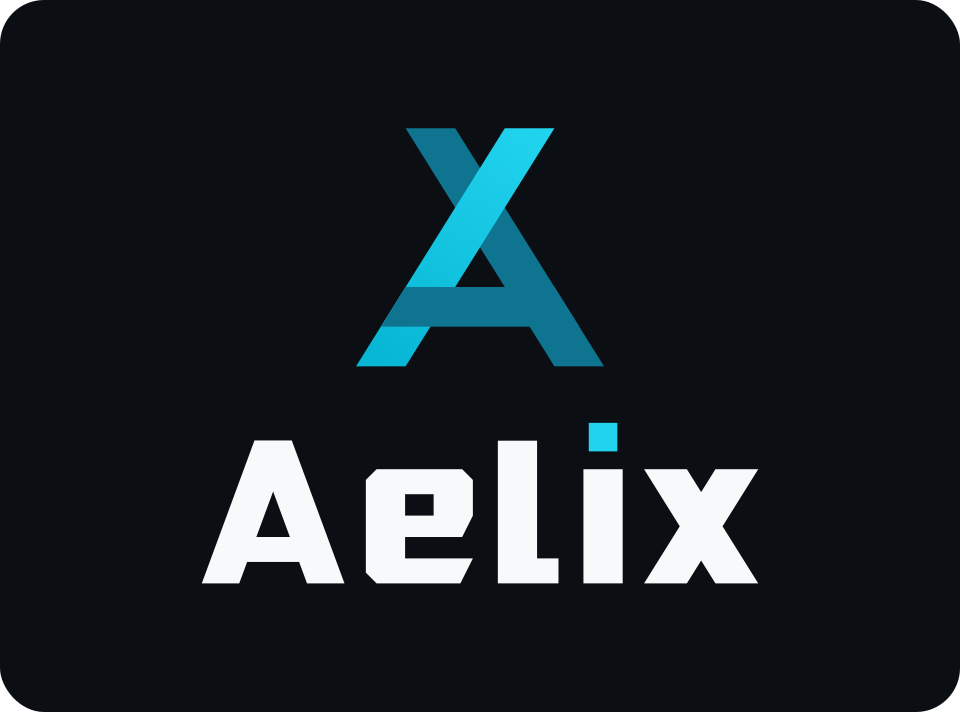
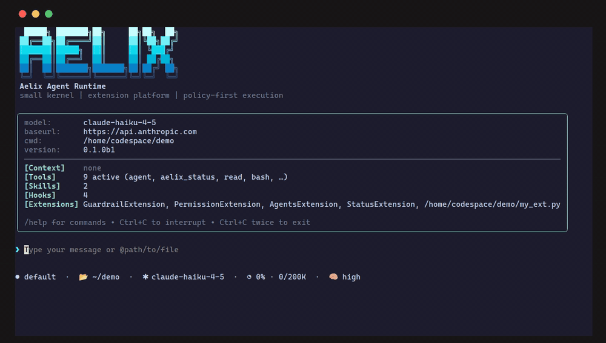

<p align="center">
  
</p>

<p align="center">
  <strong>Your own agent world — built on the Python ecosystem.</strong>
</p>

<p align="center">
  <a href="README.ko.md">한국어 README →</a>
</p>

<p align="center">
  <a href="LICENSE"></a>
  <a href="https://www.python.org/"></a>
</p>

Aelix is a small core. The plugins and extensions are the ecosystem, and an extension is
just a Python function — so the stack you already work in becomes the agent's toolbox.
Self-hosted, auditable, and running on the model budgets you already pay for.

<p align="center">
  
</p>
<p align="center"><em>The agent extends itself: it authors a <code>duckdb_query</code> tool into <code>my_ext.py</code>, <code>/reload</code> hot-loads it without restarting, and the very next prompt runs it in-process. Idle waits are cut and the recording plays at 2×.</em></p>

---

## What Aelix is

An agent runtime and extension platform in pure Python. It ships today as a terminal coding
agent — its first workload, not its boundary. Read every line it runs, keep it entirely
inside your own perimeter, and extend it with plain Python functions that import your
existing stack — DuckDB, an internal SDK, a warehouse client — directly, in-process.

It sends nothing about you anywhere; there is no telemetry. It does make a few requests for
itself, and they are the whole list: a once-a-day release check (interactive sessions only —
headless runs never check, and `/settings` → **Check for updates** turns it off from the
next launch), the model catalog check (models published between releases: at launch, when
a model picker opens, on a `/model` that matched nothing and after `/login`, at most every
4 hours, and whenever you run `aelix update --models`; it sends the aelix version;
`/settings` → **Check model catalogs** leaves only the command), the
first-use `ripgrep`/`fd` download, and the extension-catalog fetch. `--offline` skips
the checks, downloads and HTTP(S) catalog refreshes. Registered Git-over-SSH catalogs
can still refresh, explicit Git sources can contact their remotes, and model requests
use the configured endpoint. See [Trust and self-hosting](#trust-and-self-hosting).

## Install

Aelix installs from GitHub Releases through a checksum-verified installer. It
bootstraps [uv](https://docs.astral.sh/uv/) if needed, verifies every Aelix wheel
against the release's `SHA256SUMS` manifest, and installs the global `aelix`
command pinned to the version that manifest named.

```bash
# macOS, Linux
curl -fsSL https://raw.githubusercontent.com/handochan/aelix-ai/main/install.sh | sh
```

```powershell
# Windows — EXPERIMENTAL, and needs v0.1.0-beta.2 or newer (PowerShell 5.1+)
powershell -ExecutionPolicy Bypass -c "irm https://raw.githubusercontent.com/handochan/aelix-ai/main/install.ps1 | iex"
```

Windows became usable in `v0.1.0-beta.2`, and the installer takes the newest
release — so pinned to an older one, that line installs a build where none of
this works. Scope and evidence: [Platform support](#platform-support).

Both read the same environment variables: `AELIX_VERSION` pins a release tag
(`vX.Y.Z`, e.g. `v0.1.0`), `AELIX_EXTRAS` picks extras (default `tui`; empty installs the
headless CLI, POSIX only), `AELIX_PYTHON` requests the interpreter (by default
the range the release being installed runs on: `>=3.11,<3.15` from
`v0.1.0`, `>=3.11,<3.14` before it, whose pinned OpenAI SDK dies mid-turn
on 3.14 — left alone, `uv tool install` takes the newest interpreter on the
machine), `GITHUB_TOKEN` lifts the anonymous GitHub API rate limit. Each has to reach the shell on the *far* side of the pipe, which is what
makes the obvious spelling wrong on both platforms — `VAR=x curl … | sh` sets it
for `curl` alone, and from a PowerShell prompt `powershell -c "$env:VAR=…"` is
expanded by the outer shell before the child sees it (measured on pwsh 7.6). The
[getting-started guide](docs/guides/getting-started.md#windows) gives the form
that works on each. Re-run the same line to upgrade; it carries over the
extensions you installed with `aelix extension install`, and names each one it
cannot carry: one whose files, entry points or dependencies come out different,
with the command that reinstalls it; one whose source is gone, with why there is
none; and one uv could not install with the new release, right after uv's own
message, as `uv could not install it with aelix <version>`, with a command only
for an index install, whose index may be one the installer does not use (#926,
[ADR-0321](docs/decisions/0321-an-aelix-reinstall-keeps-the-installed-extensions.md)).
On a `PATH` miss both installers now run `uv tool update-shell` for you instead
of printing it.
**Up to `v0.1.0-beta.2`, upgrade through that line, not through
`uv tool install aelix@latest`** — uv suggests the latter itself, and it rebuilds
the environment on the newest Python on the machine, which for beta.2 means 3.14
and a mid-turn crash (#262). Measured: it overwrites a correct 3.13 install.
From `v0.1.0` aelix supports Python 3.14 (#278): its OpenAI SDK floor is
the first release that runs there, and CI tests 3.14 on Ubuntu and Windows. The
install line stays the recommended path, since it is the one that checks
`SHA256SUMS`.
`uv tool uninstall aelix` removes it.

> [PyPI publishes `0.1.0`](https://pypi.org/project/aelix/0.1.0/#files), a final release,
> so `uv tool install 'aelix[tui]'` and `pipx install aelix` resolve it with no pre-release
> flag ([ADR-0240](docs/decisions/0240-a-pre-release-tag-publishes-to-pypi-too.md)).
> Before `0.1.0b2`, the four PyPI names carried metadata-only `0.0.0a0` reservations.
> The recommended installer above verifies the release's `SHA256SUMS`. Re-run it
> to upgrade an installation it created.

## Platform support

macOS, Linux and Windows. On macOS and Linux CI runs `install.sh` end to end
(`ubuntu-latest` and `macos-latest`, six passes each, #279, #278); the test suite
itself runs on Ubuntu and Windows. Windows became usable in `v0.1.0-beta.2` and has the
thinnest evidence of the three: CI runs the full suite on `ubuntu-latest` and
`windows-latest` under Python 3.11, 3.12, 3.13 and 3.14 and runs `install.ps1` end to end
under both pwsh and Windows PowerShell 5.1, and on 2026-09-09 one person drove
the beta.2 candidate on one Windows machine — a `bash` call's Korean output came back
as Korean, the model reported it was on PowerShell and used PowerShell syntax
instead of `&&`, and the TUI drew correctly on a Windows console. That is the
whole of beta.2's Windows evidence: one person, one machine, one locale, plus a green leg. No
long-running use, no second machine, no third locale, and three of beta.2's
Windows fixes are argued from source and CI alone. For 0.1.0, the `candidate-smoke`
jobs in [`release.yml`](.github/workflows/release.yml) install the candidate wheels on
Windows, macOS and Linux and require an installed one-shot print turn against a local
stub before publication. The workflow defines that gate; it is not by itself a record
of a passing 0.1.0 candidate.

A program that opens the Windows console directly — a git credential prompt,
`Read-Host -AsSecureString`, `Get-Credential` — can still prompt there and burn a
command's whole timeout. Nothing in this release touches that, and no test on the
leg reaches it.

Which fix is measured how, and what is still open:
[getting-started → Windows](docs/guides/getting-started.md#windows) and
[`SLICE-STATUS.md`](SLICE-STATUS.md); the port is tracked in
[#110](https://github.com/handochan/aelix-ai/issues/110).

## Quick start

```bash
aelix                                            # interactive agent (TUI)
aelix --print "what changed in this repo?"       # one-shot, headless
aelix --model anthropic/claude-haiku-4-5 "summarise this repo"
aelix status                                     # trust, extensions, TLS — starts no session
aelix docs                                       # the guides, bundled in the wheel
```

Aelix needs a provider credential: set `ANTHROPIC_API_KEY` / `OPENAI_API_KEY` /
`OPENROUTER_API_KEY`, run `/login` inside the TUI (Copilot / subscription OAuth), pass
`--api-key`, or configure `~/.aelix/agent/models.json`. See the
[credentials guide](docs/guides/credentials.md).

On first use of `grep` or `find`, Aelix downloads `ripgrep` and `fd` into
`~/.aelix/agent/bin` so both honour `.gitignore`. These are the only binaries fetched at
runtime, `--offline` skips them, and copies already on your `PATH` are preferred.
The `@` file menu uses that same `fd` when it can find one, so it stops offering the
files git ignores — type the directory to reach them anyway (`@target/`), or turn
`/settings` → **Gitignore in @ menu** off. Without an `fd` it falls back to a directory
walk that applies no ignore rules. Either enumerator stops after 20 000 paths, and with
ignore rules off a big ignored build tree can eat that budget before your own
directories are reached.

## Why Aelix

- 🐍 **Extensions are just Python.** A tool is a plain function — no plugin language, no
  out-of-process bridge. The same `ExtensionAPI` registers tools, slash commands, providers,
  renderers, themes and your own `/login` flow, and every extension hot-reloads without a
  restart. Even policy and guardrails are swappable built-in extensions.
- 💳 **Runs on the budget you already own.** Anthropic, OpenAI, OpenRouter, Gemini/Vertex,
  Cloudflare and the GitHub Copilot seat you already sign in with. Route cheap work and hard
  reasoning to different models in one session. No metered credits, no new vendor.
- 🔍 **Auditable and self-hosted.** Fully open source, no telemetry, built for closed
  networks. `--offline` skips automatic downloads and HTTP(S) catalog refreshes. Trust lives in code you
  can read — the answer to *"why run an agent I didn't write?"*
- ⚙️ **Scriptable and headless.** `--print`, line-delimited `--mode json`, and a `--mode rpc`
  JSONL protocol make Aelix embeddable in pipelines, CI and evaluation loops.

## Extensions are just Python — query your data stack in-process

An extension is a `setup(aelix)` function. No plugin language, no bridge, so a tool imports
your existing stack and hands results straight back to the model:

```python
# my_ext.py  —  loads with:  aelix -e ./my_ext.py
from typing import Any

import duckdb                              # your own dependency, imported in-process

from aelix_coding_agent.extensions.api import ExtensionAPI
from aelix_agent_core.types import AgentTool
from aelix_ai.tools import ToolExecutionContext, ToolResult
from aelix_ai.messages import TextContent


async def _query(args: dict[str, Any], context: ToolExecutionContext) -> ToolResult:
    # DuckDB reads Parquet/CSV/JSON in place — no load step, no copy.
    rel = duckdb.sql(args["sql"]).limit(args.get("limit", 20))
    return ToolResult(content=[TextContent(text=str(rel))])


def setup(aelix: ExtensionAPI) -> None:
    aelix.register_tool(AgentTool(
        name="duckdb_query",
        description="Run DuckDB SQL straight against Parquet/CSV/JSON files. No load step.",
        parameters={
            "type": "object",
            "properties": {
                "sql": {"type": "string", "description": "SELECT … FROM 'data/*.parquet'"},
                "limit": {"type": "integer", "description": "Max rows returned (default 20)."},
            },
            "required": ["sql"],
        },
        execute=_query,
    ))
```

**Embed it anywhere Python runs** — a notebook, an Airflow/Prefect/Dagster task, a CI job:

```bash
aelix --print "which channels in data/orders.parquet have missing churn scores?"
aelix --mode json "run the eval suite and summarise failures"   # line-delimited events
```

See [writing an extension](docs/guides/extension-authoring.md) for the full surface, and the
[Aelix Marketplace](https://handochan.github.io/aelix-marketplace/) — the catalog Aelix reads
by default. Run `aelix extension discover` to see the cached official catalog. Use `aelix extension discover --refresh` to update it.

## Providers

Adapters are hand-written and keyed by **wire protocol**, not by vendor — no litellm, no
generic wrapper layer — so provider-specific behaviour (Anthropic thinking-block replay,
per-model `/responses` vs `/chat/completions` routing, Copilot enterprise host resolution)
is preserved rather than flattened. Six adapters exist, and catalog providers ride them:
OpenRouter and Cloudflare Workers AI both run on `openai-completions`, while every bundled
OpenAI model runs on `openai-responses`.

| Provider                               | Runs on               | Status          |
| -------------------------------------- | --------------------- | --------------- |
| Anthropic                              | `anthropic-messages`  | ✅ supported    |
| OpenRouter                             | `openai-completions`  | ✅ supported    |
| GitHub Copilot (individual / Business) | mixed                 | ✅ supported    |
| OpenAI                                 | `openai-responses`    | 🧪 experimental |
| GitHub Copilot (Enterprise)            | mixed                 | 🧪 not live-tested |
| Google Gemini / Vertex                 | `google-*`            | 🧪 experimental |
| Cloudflare Workers AI                  | `openai-completions`  | 🧪 experimental |

Every bundled OpenAI model routes through `openai-responses`, so choosing one puts you on the
experimental row; the `openai-completions` adapter's real traffic is OpenRouter, Cloudflare and
other OpenAI-compatible hosts.

Copilot Enterprise is implemented and unit-tested — host resolution, domain prompting,
persistence — but has never been exercised against a live Enterprise seat.

Three catalogued providers have **no adapter in this build** (`amazon-bedrock`,
`azure-openai-responses`, `mistral`). The `/model` picker hides them and dispatch refuses them
with a message naming the protocols it does support — but `--list-models` will still print them
if you set their API key. See the [providers guide](docs/guides/providers-and-models.md).

## Trust and self-hosting

Built for closed networks and customer-site deployment. `--offline` skips the `rg`/`fd`
download, HTTP(S) catalog fetches, and the update check. Registered Git-over-SSH catalogs can
still be refreshed. Extension installs and updates disable
package-index lookups when no explicit or registered index is selected (#806). The configured
model provider still needs a reachable endpoint. `aelix --offline status`,
`aelix --offline docs`, and `aelix --offline extension …` run their commands.
`aelix --offline update --models` reaches the update command and skips the refresh.
Only `--offline` may precede these root commands; other launch options cause a usage error
(exit 2). For an intentional agent prompt, use `aelix -p status` or `aelix -- status`.
`status` and `docs` require the offline flag before the command; their own parsers reject it
afterward. A `git+https://` install target still proceeds regardless of offline mode.
Policy and guardrails run as built-in
extensions, so every tool call and context mutation is an auditable hook event.

Built extension artifacts carry a signed supply chain that survives an air-gapped install —
`aelix extension keygen | sign | trust add`, and `install --require-signature` is fail-closed.
It covers artifacts installed by path or from an index; a `git+` target and an editable
directory are **refused** under that flag rather than verified. It is also **not** on by
default: no first-party keys are provisioned yet, so without the flag a missing signature is
accepted on first use.

One input is deliberately **not** gated: an `AGENTS.md` found between your working directory
and the filesystem root is read into the system prompt whether or not you trusted the project,
and its text then goes to your configured provider. `--no-context-files` turns that off. See
[SECURITY.md](SECURITY.md) and the [project trust guide](docs/guides/project-trust.md).

## System prompt files

Customize every launch with `~/.aelix/agent/APPEND_SYSTEM.md`, or one trusted
project with `.aelix/APPEND_SYSTEM.md`. `SYSTEM.md` in the same locations
replaces the entire generated base prompt. CLI prompt flags take precedence,
and the startup `[Context]` row shows loaded paths. Files are read again on
`/reload` and session rebuilds. See the [system prompt guide](docs/guides/getting-started.md#system-prompt-files)
for precedence, agent profiles and Project Trust.

## Known limitations

Six things worth knowing before you point Aelix at something that matters.

**A run has no spend ceiling.** No iteration cap, no duplicate-call detection, no
cumulative token or cost budget — a model that keeps calling tools keeps costing
money until it finishes or you stop it. `Esc`, the 600 s `bash` *default* timeout
(an explicit per-call value is honoured up to an hour) and automatic compaction are
real backstops; none of them bounds spend
([#14](https://github.com/handochan/aelix-ai/issues/14), an iteration cap and
duplicate-call detection, closed with the decision to build them as an extension
if they are needed; [#6](https://github.com/handochan/aelix-ai/issues/6),
[#52](https://github.com/handochan/aelix-ai/issues/52)). A delegated agent has no
time limit either: it runs until it finishes or you stop it — `Esc` or `Ctrl+C`,
during a turn and during `/agents run`
([#604](https://github.com/handochan/aelix-ai/issues/604)).

**A headless parent's default gate auto-approves mutating tools.** `--print`, `--mode json` and
`--mode rpc` have no terminal for an approval dialog, so `write`, `edit`, `bash` and
every tool from an MCP server or an extension run without asking. `--permission-mode
plan` does hold there: since [#188](https://github.com/handochan/aelix-ai/issues/188)
the gate treats any tool that is not one of Aelix's own read-only tools as mutating,
so plan blocks MCP and extension tools too, and an interactive run asks before each
one ([ADR-0253](docs/decisions/0253-the-permission-gate-treats-any-tool-it-does-not-know-as-mutating.md)).
`GuardrailExtension`'s hard-deny patterns still go by bare tool name, whatever
registered the tool: an extension tool named `shell` or `write_file` is checked, and
an MCP tool, which is always named `<server>__<tool>`, is not. Give a headless run a
container or a checkout you can throw away. A child delegated under `default`
falls back to `plan` without an approver. An RPC host that opts in can answer
its approval requests ([child approvals](docs/guides/agent-approvals.md)).

**One writer per persistent session.** On filesystems that support locking,
opening a session owned by another terminal offers **Fork**, **Open read-only**
or **Cancel** at interactive startup. Headless startup refuses the contested
session and suggests opening another session or using `--fork`. See the
[two-terminal guide](docs/guides/getting-started.md#two-terminals-on-one-session)
([#137](https://github.com/handochan/aelix-ai/issues/137)).

**Transcripts keep everything, forever, unredacted.** Every prompt, tool argument
and tool result is written verbatim — a delegated agent's too, in a session file
of its own beside yours ([#199](https://github.com/handochan/aelix-ai/issues/199)) — and there is no scrubbing pass. They are
owner-only on macOS and Linux (`0600` inside `0700`), and Windows has no mode-bit
equivalent for Aelix to set — either way the exposure is to whatever copies your
home directory: backups, sync clients, support bundles
([#138](https://github.com/handochan/aelix-ai/issues/138)).

**Check the `bash` output when the drain reaches its limit.** The tool reports
`Output may be incomplete` when it cannot confirm the final output. On Windows,
a reader delayed across the last pipe check can still miss trailing bytes.
Redirect output to a file when the tail matters
([#260](https://github.com/handochan/aelix-ai/issues/260)).

**Delegation cleanup varies by platform.** On macOS, the child exits after its
command inbox closes when the parent dies (#123). The
[cleanup measurements](docs/guides/background-jobs.md#if-aelix-itself-dies)
cover the tested delegation cases and the separate top-level background
`bash` case. See the [escaped-helper limits](docs/guides/agent-profiles.md#resuming-an-agent)
for processes outside the cleanup mechanism
([#110](https://github.com/handochan/aelix-ai/issues/110)).

### Also open in 0.1.0

These issues are open in 0.1.0 as well. Each line says when it applies and
links the issue. The `[0.1.0]` section of the [CHANGELOG](CHANGELOG.md) opens
with the same issues. Windows is experimental
([Platform support](#platform-support)).

#### In everyday use

- Near a full context window the output limit shrinks to the room left. An
  answer cut at that limit stays as the turn's answer, and its tool calls still
  go to execution with what the adapter recovered of their arguments: the
  OpenAI-compatible and Responses adapters keep what parsed before the cut and
  drop a value cut mid-string, and the Anthropic adapter uses `{}` when the
  arguments do not parse. This comes from reading the code; whether a cut
  argument can pass validation and run was not measured
  ([#569](https://github.com/handochan/aelix-ai/issues/569)).
- Logging out of an OAuth login in one aelix does not reach another aelix that
  is already running. That one keeps sending its cached token until the token
  expires. Its request then fails, and the error asks you to remove an
  `auth.json` entry that is already gone. Restart other sessions after `/logout`
  ([#481](https://github.com/handochan/aelix-ai/issues/481)).
- `defaultThinkingLevel` applies only at launch. If a session starts on a model
  that cannot reason and you switch with `/model` to one that can, thinking stays
  off until you choose a level with `/thinking`
  ([#499](https://github.com/handochan/aelix-ai/issues/499)).
- `/thinking <level>` does not check the level. A typo or `HIGH` is shown as
  accepted and recorded in the session, and the request is sent at the model's
  first level, usually `off`. Use the lowercase names the `/thinking` picker shows
  ([#582](https://github.com/handochan/aelix-ai/issues/582)).
- `/cost` and `/stats` price only built-in catalog models. For a model defined
  in `models.json`, even with `cost` set, RPC `get_session_stats` reports `0.0`
  and `/cost` shows `n/a` (measured on a custom provider's model). After a
  delegation both show only the delegated agent's share, `/cost` as `≥`. A
  `modelOverrides` cost on a built-in model is ignored: RPC reports the catalog
  price, and the TUI was not measured
  ([#739](https://github.com/handochan/aelix-ai/issues/739)).
- If `SSL_CERT_FILE` points at a file that does not exist, `aelix -p` on a
  provider that uses the OpenAI SDK client prints an unrelated traceback and
  then a `[Errno 2] No such file or directory` that names no file. Check the
  path that `aelix status` shows. The Anthropic and Google adapters were not
  measured ([#557](https://github.com/handochan/aelix-ai/issues/557)).
- The `/model` picker lists google-vertex rows for Claude and for partner models
  (Llama, gpt-oss, DeepSeek, Qwen, GLM, Kimi). aelix sends them Gemini's request
  format, so they cannot work; reach those models through Anthropic or
  OpenRouter. This comes from reading the code; it was not run against Vertex
  ([#560](https://github.com/handochan/aelix-ai/issues/560)).
- Under `--permission-mode auto` (opt-in; the default posture is `default`),
  with dash as your shell, a few forms run without a dialog although dash runs
  part of them as a command: `(( 1>FILE ))` creates `FILE`, and
  `(( crontab -r ))` is allowed although dash would run `crontab -r` (classified
  only; dash's reading was checked with `echo` in the command's place). With
  dash, ksh93 or mksh, `echo $[2>FILE]` creates `FILE]`. The classifier reads
  every shell as one POSIX dialect; a write to a protected path such as
  `~/.bashrc` is still refused
  ([#793](https://github.com/handochan/aelix-ai/issues/793)).
- `aelix --agent <profile> --model <id>` runs on `<id>`, as intended, and its
  notice says `CLI flags override model` without naming the model the profile
  asked for. `/agents use` in a session started with `--model` says the same
  ([#157](https://github.com/handochan/aelix-ai/issues/157)).
- The `/model` picker's detail line names the provider's environment variable
  (`API Key: OPENAI_API_KEY`) whatever the key's real source, such as
  `--api-key`, `auth.json` or `models.json`
  ([#377](https://github.com/handochan/aelix-ai/issues/377)).
- In the TUI, a prompt on a model that was not found at startup is refused with
  the general `could not be resolved to a known API protocol` text, not the
  not-found reason that the startup warning gave
  ([#378](https://github.com/handochan/aelix-ai/issues/378)).
- A saved session drawn again (`/resume`, `--continue`, `--resume`) shows an
  `edit` result without its diff and a `bash` result without its `exit N` row,
  because a saved tool result keeps no `details`. This comes from reading the
  code ([#168](https://github.com/handochan/aelix-ai/issues/168)).
- The guide lists are kept by hand, not generated from the guide files. This
  README's [Docs](#docs) line links 10 of the 16 guides; `aelix docs` and the
  [guide index](docs/guides/README.md) list all 16
  ([#265](https://github.com/handochan/aelix-ai/issues/265)).
- No CI gate fails when a slash command, an RPC command or an environment
  variable has no doc entry. On 2026-09-12 the issue counted 20 of 36 slash
  commands, 29 of 29 RPC commands and 34 of 65 environment variables, among
  other surfaces, with no doc entry. They were not re-counted for 0.1.0
  ([#267](https://github.com/handochan/aelix-ai/issues/267)).

#### Scripts and RPC hosts

- `aelix -p` exits 0 when the answer was cut at the model's output-token limit,
  and nothing on stderr says so
  ([#543](https://github.com/handochan/aelix-ai/issues/543)).
- `message_update`, `get_session_stats` and `agents/run` can carry a `NaN` or
  `Infinity` cost, which a strict JSON reader rejects
  ([#875](https://github.com/handochan/aelix-ai/issues/875)).
- When an RPC host stops a background agent with `children/stop`, the two
  reports disagree and neither names the host: the `aelix_child` end frame says
  the session stopped it, and the model's job result says the user stopped it
  with `/jobs` ([#855](https://github.com/handochan/aelix-ai/issues/855)).
- For an extension that failed to load and whose file name holds a lone
  surrogate, sending its read-only tool row's key to `selections/set` gets an
  unknown-row error instead of the row's refusal, and the row shares its `group`
  with the U+FFFD spelling of the same name
  ([#876](https://github.com/handochan/aelix-ai/issues/876)).
- An RPC host cannot yet observe where an in-flight input came from, or when it
  was consumed or withdrawn
  ([#865](https://github.com/handochan/aelix-ai/issues/865)).

#### Extension authors

- `ctx.abort()` stops retries but not a model request that is still streaming
  ([#545](https://github.com/handochan/aelix-ai/issues/545)).
- A turn that an extension starts with `send_message(…, trigger_turn=True)` while
  the TUI is idle cannot be stopped with Esc or Ctrl+C. Only the double Ctrl+C
  that quits aelix ends it
  ([#674](https://github.com/handochan/aelix-ai/issues/674)).
- A tool that catches cancellation and keeps running holds the turn: Esc does
  nothing in a sequential batch, and after a parallel batch it holds `/exit` and
  survives the first SIGTERM. Built-in tools are not affected
  ([#692](https://github.com/handochan/aelix-ai/issues/692)).
- An extension dialog opened while another dialog is open replaces it, and the
  first one never returns. If the first was a tool approval, the turn waits until
  Esc ([#713](https://github.com/handochan/aelix-ai/issues/713)).
- When an extension's shortcut handler raises, its warning and traceback are
  written over the TUI's input line and footer. An invalid descriptor module's
  warning prints the same way, before the first screen. The other 36 such
  warnings, for themes, widgets and descriptors among them, take the same path
  in the code; they were not each run
  ([#714](https://github.com/handochan/aelix-ai/issues/714)).
- `ctx.ui.custom()` components receive no keys: `handle_input` is never called
  and Esc does not close them, so input is blocked until the extension calls
  `done()` ([#715](https://github.com/handochan/aelix-ai/issues/715)).
- An `input` or `before_agent_start` handler that never returns, such as a dialog
  nobody answers, holds `/new`, `/resume` and quit until it returns. Over RPC
  such a dialog ends after 300 s
  ([#851](https://github.com/handochan/aelix-ai/issues/851)).
- Two kinds of `tool_result` hook bring back a cancelled delegation's report
  unmasked: one that raises, and one that rewrites the result to exactly the cut
  marker. The report copy sent with the next prompt then carries the unmasked
  text to the model and the session file. A hook that rewrites to any other
  text, such as `[redacted]`, is honoured
  ([#839](https://github.com/handochan/aelix-ai/issues/839)).
- If a newer wheel of an extension drops its `aelix.extensions` entry point,
  `aelix extension update <name>` can reinstall the older version that a bundle
  pinned and still exit 0
  ([#878](https://github.com/handochan/aelix-ai/issues/878)).
- A new session whose `session_start` handler starts a turn
  (`send_message(…, trigger_turn=True)`) opens in the TUI with
  `↻ Resumed session (N messages)`, though nothing was resumed
  ([#373](https://github.com/handochan/aelix-ai/issues/373)).
- On a launch whose model route is not decided yet, a turn that a
  `session_start` handler requests with `trigger_turn=True` and does not wait
  for is refused after the handlers end, and the refusal still says
  `No turn runs while this session's session_start handlers run`
  ([#372](https://github.com/handochan/aelix-ai/issues/372)).
- Code that calls the Google or Vertex adapter itself with `reasoning="off"` as
  a string does not turn thinking off: a probe sent `gemini-2.5-pro`
  `thinkingBudget: 32768`. `--thinking off` and `/thinking off` are not
  affected ([#259](https://github.com/handochan/aelix-ai/issues/259)).

#### Windows (experimental)

- `auth.json` has no cross-process lock on Windows. Two aelix processes saving
  or refreshing a login at the same moment can lose one update, or leave a file
  that aelix resets to empty, which removes every saved login. Run `/login`
  again if that happens ([#46](https://github.com/handochan/aelix-ai/issues/46)).
- Choosing "Trust parent folder" from inside a junction or symlink saves the
  link's parent, not the real project's parent. The trust does not apply on the
  next launch, and the folder that holds the link is trusted instead
  ([#584](https://github.com/handochan/aelix-ai/issues/584)).
- When a session is open in another window, aelix cannot say whether Aelix
  Studio or the CLI holds it; the holder is reported as unknown
  ([#881](https://github.com/handochan/aelix-ai/issues/881)).
- Piping into `aelix` from a source that never writes hangs with no message:
  `AELIX_STDIN_TIMEOUT` applies only on macOS and Linux
  ([#107](https://github.com/handochan/aelix-ai/issues/107)).

## Architecture

Five packages (a uv workspace), orchestrated by `Agent` and `AgentHarness`:

- **`aelix-ai`** — provider-agnostic messages, streaming primitives, tool definitions. No loop, no hooks.
- **`aelix-agent-core`** — the agent loop, `Agent`, `AgentHarness`, and the typed `HookBus`. No extension deps.
- **`aelix-coding-agent`** — `ExtensionAPI`, extension loader, built-in `PolicyExtension` / `GuardrailExtension`.
- **`aelix-server`** — a local daemon that serves the RPC protocol over HTTP (a WebSocket at `/rpc`); not published to PyPI. See [its README](packages/aelix-server/README.md).
- **`aelix`** — the workspace root and the package you install (see [Install](#install)): the `aelix` command, and an umbrella module that re-exports the main names of the first three packages, which it depends on.

Small kernel, broad extension surface; policy and guardrails as built-in extensions rather
than core; an explicit hook bus for auditability. Full rationale in [`docs/`](docs/README.md).

## Docs

[Getting started](docs/guides/getting-started.md) ·
[Providers & models](docs/guides/providers-and-models.md) ·
[Credentials](docs/guides/credentials.md) ·
[Compaction](docs/guides/compaction.md) ·
[Custom models](docs/guides/models-json.md) ·
[Agent profiles](docs/guides/agent-profiles.md) ·
[Writing an extension](docs/guides/extension-authoring.md) ·
[Provider extensions](docs/guides/extension-providers.md) ·
[Project trust](docs/guides/project-trust.md) ·
[Private catalog](docs/guides/private-catalog.md) ·
[Releasing](RELEASING.md)

Every guide except `RELEASING.md` ships inside the wheel, so an installed machine reads them
with no network and no checkout — `aelix docs`, `aelix docs project-trust`,
`aelix docs --search register_tool`.

[Homepage →](https://handochan.github.io/aelix-ai/) ·
[Extension catalog →](https://handochan.github.io/aelix-marketplace/)

## Building from source

```bash
uv sync                  # create .venv and install all workspace packages
uv run pytest            # run the test suite
uv run aelix --help      # the real CLI
```

Copy `.env.example` to `.env` for live-provider credentials. A `.env` is admitted for provider
credentials and a short list of provider-configuration names, and nothing else — it is read
before Aelix knows whether it trusts the directory. That admission list is narrow but it is not
nothing: a cloned repo's `.env` **can** supply the API key your session then runs on when you
hold none of your own for that route, so the prompts go to the attacker's account — and when
your `models.json` re-points a built-in provider at a gateway, the configured extension/JSON
key precedes the environment after runtime and stored credentials
([key order](docs/guides/models-json.md#which-key-a-request-carries)). What it
cannot do is execute a program, relocate the credentials store, widen its own gate, move a
provider off its real host ([ADR-0203](docs/decisions/0203-dotenv-admission-control.md)), or
choose which provider a model string goes to — a key from a `.env` authenticates a route, it
never picks one, nor fills the host of a `{NAME}` base-URL template of yours ([ADR-0250](docs/decisions/0250-model-routing-follows-pi-and-a-dotenv-credential-cannot-choose-a-route.md)).
CA bundles, SDK knobs and base URLs belong in your shell.

## License & attribution

[Apache-2.0](LICENSE), with an explicit patent grant. The **name and logo** are separate from
the code licence, and [TRADEMARK.md](TRADEMARK.md) grants more than Apache-2.0 §6 does:
describing your work as built on, compatible with, or an extension of Aelix needs no
permission, and neither does naming your package `aelix-<something>`.

Substantial portions of Aelix are a TypeScript-to-Python port of
[pi](https://github.com/earendil-works/pi) (reference commit `734e08e`), Copyright © 2025
[Mario Zechner](https://github.com/badlogic), MIT licensed. The bundled model catalog derives
from [models.dev](https://models.dev) (MIT). Full third-party licence texts ship in every
wheel and sdist ([NOTICE](NOTICE), [THIRD-PARTY-NOTICES.md](THIRD-PARTY-NOTICES.md)); the
dependency inventory is a CycloneDX SBOM under [`sbom/`](sbom/).

Anthropic, OpenAI, Google Gemini, GitHub Copilot, OpenRouter and Cloudflare are trademarks of
their respective owners; Aelix is an independent project, and names are used only to identify
the services it can connect to.
